<!-- Banner -->
<p align="center">
  
</p>

<p align="center">
  <a href="https://github.com/Framos44">
    
  </a>
</p>

<p align="center">
  <a href="https://www.linkedin.com/in/felipe-domingos-ramos-2745692a8">
    
  </a>
  </p>

---

### `> cat sobre-mim.yaml`

```yaml
nome:        Felipe Ramos
local:       Ribeirão Preto, SP 🇧🇷
trabalho:    Data Center
formação:    Ciência da Computação (em andamento)
interesses:  [infraestrutura, IoT, sistemas embarcados, web]
projetos:    pessoais + faculdade
lema:        "Consistência transforma pequenas ações em grandes resultados ao longo do tempo."
```

---

### `> ./projeto-destaque --name SIMAEP`

<table>
  <tr>
    <td width="45%" align="center">
      <a href="https://github.com/Framos44/esp32-classroom-monitor">
        
      </a>
      <sub><i>Caixa do protótipo modelada em 3D</i></sub>
    </td>
    <td width="55%">
      <h3>
        <a href="https://github.com/Framos44/esp32-classroom-monitor">🌡️ ESP32 Classroom Monitor</a>
      </h3>
      <p>
        Monitor ambiental para salas de aula que mede <b>temperatura, umidade, luz, ruído e qualidade do ar</b>,
        com foco no <b>conforto sensorial dos alunos</b>, inclusive dos que têm sensibilidades sensoriais.
      </p>
      <p>
        ✅ Sensores + display LCD 20x4<br/>
        ✅ Alertas com LEDs e buzzer, botões de power e mute<br/>
        ✅ Envio por Wi-Fi (HTTP POST) para backend PHP + MySQL<br/>
        ✅ Dashboard web com leituras em tempo real<br/>
        ✅ Caixa modelada em 3D e site institucional<br/>
        🚧 Migração para hardware físico
      </p>
      <p>
        
        
        
        
        
        
      </p>
    </td>
  </tr>
</table>

```text
 ┌───────────────────┐                ┌──────────────────────┐
 │ DHT22 · LDR       │                │ LCD 20x4 · LEDs      │
 │ MQ2   · Som       │───▶  ESP32 ───▶│ Buzzer               │
 └───────────────────┘        │       └──────────────────────┘
                              │ Wi-Fi · HTTP POST
                              ▼
                    ┌───────────────────┐      ┌──────────────────┐
                    │   PHP + MySQL     │─────▶│  Dashboard web   │
                    └───────────────────┘      └──────────────────┘
```

---

### `> ls ~/projetos`

| Projeto | O que é | Stack |
|---|---|---|
| 🐾 [**PetMatch AI**](https://github.com/Framos44/petfinder) | App web que ajuda a reencontrar animais perdidos comparando fotos com o modelo de IA **CLIP** |   |
| 🌱 [**EcoRP**](https://github.com/Framos44/EcoRP) | Projeto web com foco ambiental em Ribeirão Preto |   |
| 🎓 [**Projeto Integrador**](https://github.com/Framos44/Projeto-Integrador) | Sistema web desenvolvido no projeto integrador da faculdade |   |

---

### `> stack --list`

<p align="center">
  
  <br/>
  
</p>

---

### `> status --github`

<p align="center">
  
</p>

<p align="center">
  
</p>

<!-- A cobrinha aparece depois que a Action "snake" rodar pela primeira vez -->
<picture>
  <source media="(prefers-color-scheme: dark)" srcset="https://raw.githubusercontent.com/Framos44/Framos44/output/github-snake-dark.svg"/>
  <source media="(prefers-color-scheme: light)" srcset="https://raw.githubusercontent.com/Framos44/Framos44/output/github-snake.svg"/>
  
</picture>

<!-- Rodapé -->
<p align="center">
  
</p>
